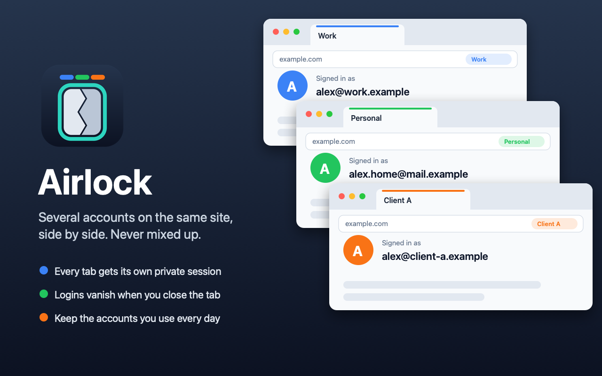

# Airlock

**Use several accounts on the same website, side by side, without them getting mixed up.**

Airlock is a Firefox add-on. Every new tab gets its own private session, an "airlock",
with its own logins. Sign into one account in this tab and a different one in the next,
and they'll never see each other. Close the tab and that login is gone.

[**Get Airlock from Firefox Add-ons →**](https://addons.mozilla.org/firefox/addon/airlock-sessions/)



---

## Why I made this

Browsers try to be helpful by remembering who you are. That's great until you have more
than one account on the same site, say work and personal, or a few clients. Then
the browser keeps signing you into the wrong one. Private windows don't help either,
because all private tabs share the same session.

Airlock gives every tab a clean slate, so you decide which account goes where.

## How to use it

| Do this | What happens |
|---|---|
| Press **⌘T** (Mac) or **Ctrl+T** (Windows/Linux) | A new tab with a fresh, signed-out session |
| Press **⌥⌘T** (Mac) or **Ctrl+Alt+T** | A new tab in the *same* session, already signed in |
| Right-click a tab | Choose "New Tab in This Airlock" or "New Airlock Tab" |
| Click the Airlock button in the toolbar | Rename the session, keep it signed in, or forget it |

**A few things worth knowing:**

- **Each session has its own color**, shown under its tabs and in the address bar. Give it a
  name like "Work" or "Client A" from the toolbar button.
- **Closing a session's last tab erases it**: its cookies, logins and saved site data.
- **Want to stay signed in to an account you use every day?** Tick **Keep** in the toolbar
  button. It stays until you click **Forget**.
- **Links from other apps** (email, chat, documents) open in a new session, not in
  whatever you were last signed into.
- **Prefer to choose when to use it?** Turn off "Give every new tab its own airlock" in the
  toolbar button. Then normal tabs stay normal, and you open Airlock tabs when you want them.

## One setting to change

Firefox has an option that can sign you into your computer's work or school account
automatically, in every tab. Add-ons aren't allowed to change it, so please turn it off yourself:

**Firefox Settings → Privacy & Security →** uncheck
*"Allow Windows single sign-on for Microsoft, work, and school accounts"* (if you see it).

That's Firefox's own name for the setting. Airlock works with any website.

Airlock turns off Firefox's password saving for you, so it can never fill in one account's
password on another account's page.

## Privacy

**Airlock doesn't collect anything.** No analytics, no tracking, and it never connects to
the internet by itself. Everything it remembers (which sessions are yours, their names,
which ones you kept) stays inside your own Firefox.

Firefox shows a list of permissions when you install an add-on. Here's what each one is for,
in plain terms:

| Firefox says Airlock can… | Why it needs that |
|---|---|
| Access your data for all websites | To catch a page *before* it loads in Firefox's shared session and open it in its own airlock instead. Airlock doesn't read or change the pages themselves. |
| Clear recent browsing history, cookies, and related data | To erase a session's logins when you close it, and only for sessions Airlock created. |
| Read and modify privacy settings | To keep Firefox's password saving turned off. |
| Access browser tabs | To open new tabs in the right session. |

The full source code is right here in this repository: plain, readable JavaScript with no
hidden or compressed code.

## Keeping it safe and up to date

See [SECURITY.md](SECURITY.md) for how updates work and how to report a problem privately.

---

## For developers

<details>
<summary>Try it, change it, release it</summary>

### Try it without installing

1. Open `about:debugging#/runtime/this-firefox` in Firefox.
2. Click **Load Temporary Add-on…** and pick `manifest.json` from this folder.

It stays loaded until Firefox quits.

### What's in here

| File | What it does |
|---|---|
| `manifest.json` | The add-on's name, version and permissions |
| `background.js` | The core: creates and erases sessions, handles shortcuts |
| `popup.html/.js/.css` | The toolbar button's menu |
| `welcome.html/.js/.css` | The setup and help page |
| `icons/` | Store icon and toolbar icons (light and dark) |
| `store/` | The store and README image |
| `tools/` | Scripts that draw the icons and store image (not part of the add-on) |

### Release a new version

1. Change `"version"` in `manifest.json` (for example `1.0.2`) and add a line to `CHANGELOG.md`.
2. Commit, then tag and push:

   ```bash
   git tag v1.0.2 && git push origin main v1.0.2
   ```

3. GitHub checks the add-on, sends it to Mozilla for signing and review, and creates a
   GitHub release. Firefox updates everyone automatically once Mozilla approves it.

This needs two repository secrets, `AMO_JWT_ISSUER` and `AMO_JWT_SECRET`, from
addons.mozilla.org → **Tools → Manage API Keys**.

To build the zip by hand instead:

```bash
zip -r ../Airlock.zip manifest.json background.js popup.html popup.css popup.js welcome.html welcome.css welcome.js icons LICENSE
```

</details>

## License

MIT: free to use, change and share. See [LICENSE](LICENSE).
