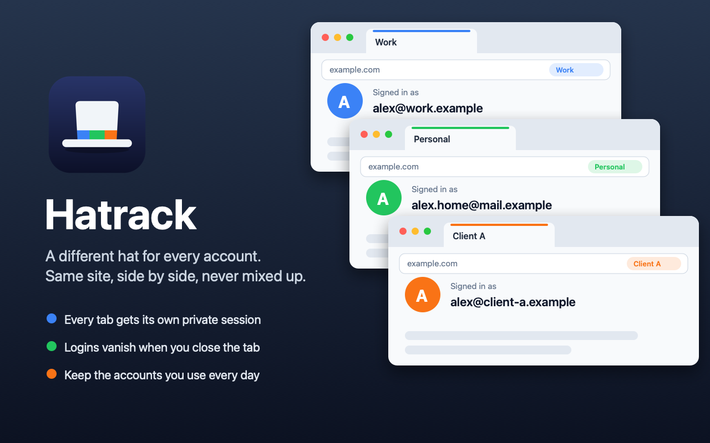

# Hatrack

**A different hat for every account.** Use several accounts on the same website, side by side, without them getting mixed up.

Hatrack is a Firefox add-on. Every new tab gets its own private session, a "hat",
with its own logins. Sign into one account in this tab and a different one in the next,
and they'll never see each other. Close the tab and that login is gone, a couple of minutes later.

[**Get Hatrack from Firefox Add-ons →**](https://addons.mozilla.org/firefox/addon/hatrack/)



---

## Why I made this

Browsers try to be helpful by remembering who you are. That's great until you have more
than one account on the same site, say work and personal, or a few clients. Then
the browser keeps signing you into the wrong one. Private windows don't help either,
because all private tabs share the same session.

Hatrack gives every tab a clean slate, so you decide which account goes where.

## How to use it

| Do this | What happens |
|---|---|
| Press **⌘T** (Mac) or **Ctrl+T** (Windows/Linux) | A new tab in a new hat: fresh and signed out |
| Press **⌥⌘T** (Mac) or **Ctrl+Alt+T** | A new tab in the *same* hat, already signed in |
| Right-click a link | "Open Link in New Hat", for a signed-out copy or a different account |
| Right-click a tab | "New Tab in This Hat" or "New Tab in a New Hat" |
| Click the Hatrack button in the toolbar | Rename the hat, keep it signed in, or forget it |

**A few things worth knowing:**

- **Each hat has its own color**, shown under its tabs, in the address bar, and on the Hatrack
  button (as its number or initials). Give it a name like "Work" or "Client A" from the toolbar button.
- **Closing a hat's last tab erases it**: its cookies, logins and saved site data. By default it
  waits 2 minutes first, so you can reopen a tab you closed by accident (⇧⌘T) still signed in.
  You can change the wait, or make it immediate, on the setup page.
- **Want to stay signed in to an account you use every day?** Tick **Keep** in the toolbar
  button. It stays until you click **Forget**.
- **Links from other apps** (email, chat, documents) can open in a new hat instead of
  whatever you were last signed into. This is optional: switch it on from the setup page.
- **Prefer to choose when to use it?** Turn off "Give every new tab its own hat" in the
  toolbar button. Then normal tabs stay normal, and you open Hatrack tabs when you want them.

## One setting to change

Firefox has an option that can sign you into your computer's work or school account
automatically, in every tab. Add-ons aren't allowed to change it, so please turn it off yourself:

**Firefox Settings → Privacy & Security →** uncheck
*"Allow Windows single sign-on for Microsoft, work, and school accounts"* (if you see it).

That's Firefox's own name for the setting. Hatrack works with any website.

Hatrack turns off Firefox's password saving for you, so it can never fill in one account's
password on another account's page.

## Privacy

**Hatrack doesn't collect anything.** No analytics, no tracking, and it never connects to
the internet by itself. Everything it remembers (which hats are yours, their names,
which ones you kept) stays inside your own Firefox.

Firefox shows a list of permissions when you install an add-on. Here's what each one is for,
in plain terms:

| Firefox says Hatrack can… | Why it needs that |
|---|---|
| Clear recent browsing history, cookies, and related data | To erase a hat's logins when you close it, and only for hats Hatrack created. |
| Read and modify privacy settings | To keep Firefox's password saving turned off. |
| Access browser tabs | To open new tabs in the right hat. |
| Access your data for all websites *(only if you turn on "links from other apps")* | To catch a page *before* it loads in Firefox's shared session and open it in its own hat instead. Hatrack doesn't read or change the pages themselves. Turn the option off and Hatrack gives this permission back. |

The full source code is right here in this repository: plain, readable JavaScript with no
hidden or compressed code.

## Keeping it safe and up to date

See [SECURITY.md](SECURITY.md) for how updates work and how to report a problem privately.

---

## Who maintains Hatrack

Hatrack is built and maintained by [mbaker-wv](https://github.com/mbaker-wv). Only the maintainer
can change this repository or publish new versions on Firefox Add-ons. Every version is also
reviewed and signed by Mozilla before it reaches you.

**Found a bug or have an idea?** [Open an issue](https://github.com/mbaker-wv/hatrack/issues).
For security problems, please use the private report described in [SECURITY.md](SECURITY.md).

---

## Maintainer notes

<details>
<summary>How the code is organized, and how new versions are released</summary>

### Look at it without installing

Anyone can try the code locally without changing anything here:

1. Open `about:debugging#/runtime/this-firefox` in Firefox.
2. Click **Load Temporary Add-on…** and pick `manifest.json` from a downloaded copy of this repository.

It stays loaded until Firefox quits.

### What's in here

| File | What it does |
|---|---|
| `manifest.json` | The add-on's name, version and permissions |
| `background.js` | The core: creates and erases sessions, handles shortcuts |
| `popup.html/.js/.css` | The toolbar button's menu |
| `welcome.html/.js/.css` | The setup and help page |
| `icons/` | Store icon and toolbar icons (light and dark) |
| `store/` | Store screenshots (also used in this README) |
| `tools/` | Scripts that draw the icons and screenshots (not part of the add-on) |
| `tests/` | Behavior tests, run by GitHub on every change: `node tests/run.js` (not part of the add-on) |

### Releasing a new version (maintainer only)

1. Change `"version"` in `manifest.json` (for example `1.0.2`) and add a line to `CHANGELOG.md`.
2. Commit, then tag and push:

   ```bash
   git tag v1.0.2 && git push origin main v1.0.2
   ```

3. GitHub checks the add-on, sends it to Mozilla for signing and review, and creates a
   GitHub release. Firefox updates everyone automatically once Mozilla approves it.

This uses the maintainer's own Mozilla API keys, stored as private repository secrets
(`AMO_JWT_ISSUER` and `AMO_JWT_SECRET`).

To build the zip by hand instead:

```bash
zip -r ../Hatrack.zip manifest.json background.js popup.html popup.css popup.js welcome.html welcome.css welcome.js icons LICENSE
```

</details>

## License

The code is open source under the MIT license, so you're free to read it, learn from it and
reuse it in your own projects. See [LICENSE](LICENSE). The Hatrack name, its listing on Firefox
Add-ons and this repository remain the maintainer's.
